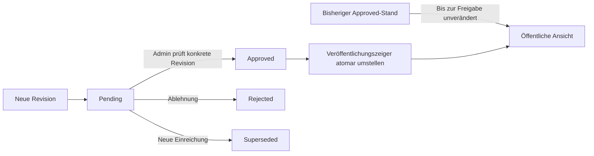

# MedDocs-Kommentare – Architekturkonzept Phase 3A

Stand: **11. Oktober 2026**. Status: **Historisches Phase-3A-Konzept**.

Phase 3B wurde danach lokal implementiert. Verbindliche Entscheidungen,
Abweichungen, Sicherheitsgrenzen und Rollout stehen in
[Phase 3B](meddocs-comments-phase3b.md). Insbesondere gibt es im MVP keine
öffentliche Revisionshistorie. Aussagen zum nicht implementierten Stand unten
beschreiben ausschließlich die ursprüngliche Phase 3A.

Dieses Dokument beschreibt Phase 3B und spätere Erweiterungen. Es legt keine
Migration an, aktiviert keine Funktion und erteilt keine Deployment-Freigabe.
Nur dieses Konzept wird in Phase 3A hinzugefügt. Alle Mengenlimits unten sind
vorgeschlagene Produktwerte, keine Anbieterquoten oder gesetzlichen Fristen.

## 1. Vorhandene Architektur und Integrationspunkte

Die Analyse basiert auf dem aktuellen lokalen Code, einschließlich der noch
uncommitteten Account-Änderungen. Der Remote-Migrationsstand wurde nicht abgefragt.

| Bereich | Lokaler Befund | Konsequenz |
| --- | --- | --- |
| Website | Installiert: Astro 7.3.2, Starlight 0.41.10, TypeScript 6.0.3, Tailwind 4.3.3; statischer Build | Artikel bleiben statisch; Kommentare werden im Browser aus Supabase geladen. |
| Content | `src/content.config.ts`, Collection `docs`, Starlight `docsLoader()` | Keine neue Content-Collection für Kommentare. |
| Artikelkennung | `route.entry.id`, z.B. `meddocs/echokardiographie/grundlagen-technik/physikalische-grundlagen`; Loader erzeugt standardmäßig IDs aus Pfaden | Bestehende Content-ID ist für dauerhafte Diskussionen nicht ausreichend. Noch kein eigenes `articleId` im Schema. |
| Artikelabgrenzung | `article-metadata.ts`: MedDocs, normales Layout, kein Index, Hero oder Splash; redaktionelle Metadaten erforderlich | Dieselben Kriterien für den Start übernehmen, zusätzlich ausdrücklich Kommentare aktivieren und Drafts ausschließen. |
| Artikelabschluss | `MedNerdsContentFooter.astro`: Pagination, dann `MedDocsArticleInfo` | Kommentarbereich danach einsetzen. Disclaimer und globaler Site-Footer bleiben nachgelagert. |
| Kopfbereich | `MedNerdsPageTitle.astro` zeigt Terminologie; zusätzliche Description und Artikel-Metazeile wurden entfernt | Kein Kommentarumbau am Seitentitel. |
| PageFrame | `MedNerdsPageFrame.astro` verwaltet globale Integration und Fancybox | Keine Kommentare global auf allen Produktseiten initialisieren. |
| Supabase | SDK 2.117.3; `supabase-client.ts`: ein `SupabaseClient<Database>`, persistierte Session, SDK-Refresh, geteilter AuthStore | Diesen Client nutzen; keine zweite Anmeldung oder Client-Instanz. Konfiguration verlangt derzeit auch den öffentlichen Turnstile-Site-Key. |
| Typen | `database.types.ts`: generiertes Datenbankschema; `profile.ts` enthält Projekt-Aliase | Neue Typen erst nach der tatsächlich angewendeten Migration generieren; keine handgefertigte Konkurrenzdefinition. |
| Profil | `profiles.user_id → auth.users`, `display_name` nullable; Constraints/Validierung für 2–60 Zeichen; freiwillige Beruf-/Avatarfelder | Keine neue Spalte `registration_completed`. Öffentliche Schreibrechte aus der aktuellen DB-Zeile ableiten. |
| Onboarding | `account-access.ts`, `ProfileStore`, `account-element.ts` | `getAccountSetupStatus`, `getAccountFeatureAccess` und `createAccountSetupHref` für die Benutzerführung wiederverwenden. |
| Staff | `staff_accounts`: `admin` oder `author`, optional `author_slug`, eigener RLS-Lesezugriff; lokal partieller Unique-Index auf `author_slug` | Rollen aus dieser vertrauenswürdigen DB-Tabelle, nicht aus Anzeigenamen oder JWT-Profilmetadaten ableiten. Anwendung des lokalen Indexes remote nicht unterstellen. |
| Redaktion | `src/data/authors.ts`: gemeinsame Personen-Registry; `getStaffAuthor` und `isStaffAuthorOfArticle` | Redaktionelle Identität und Artikelautorschaft bleiben separate, geprüfte Zuordnungen. Die Registry enthält auch eine Demo-Person. |
| Rechtliches | `account_legal_acceptances`; private `account_legal_releases`; `get_account_legal_state`, `record_account_legal_acceptance`; Dokumentversionen als SHA-256 | Aktuellen serverseitigen Release prüfen. Frontend-Checkboxen und ältere Bestätigungen genügen nicht. Bestehende Texte sind noch keine Kommentar-Launch-Freigabe. |
| Löschung | Phase 2.2: dedizierte, standardmäßig deaktivierte Edge Function, frischer OTP, einmaliger Intent, letzter-Admin-Trigger | Neues Datenmodell muss Auth-Hard-Deletion innerhalb ihrer DB-Transaktion bereinigen; keine zweite Remote-Cleanup-Kette. |
| Tests | Node-Tests mit `node:test`/Type-Stripping, Chrome/CDP-Browser-Mocks, pgTAP-Dateien unter `supabase/tests` | Bestehende Infrastruktur erweitern, kein neues Framework. |

Die lokale Supabase-Konfiguration exponiert nur `public` und nutzt PostgreSQL 17;
`mednerds_private` ist bereits vorhanden. Hosting-Version und Rechte müssen in
Phase 3B separat geprüft werden. Die MedDocs-README enthält teilweise ältere
Beschreibungen zur Metazeile; für dieses Konzept ist der tatsächliche Code maßgeblich.

Eine bereichsübergreifende Architekturablage existiert bisher nicht. Deshalb liegt
dieses Konzept im vorgeschlagenen `docs/architecture/` und nicht unter der
Website-Content-Collection. Es wird dadurch nicht als Website-Seite veröffentlicht.

## 2. Empfohlener MVP und spätere Erweiterungen

| Funktion | Empfehlung für Phase 3B |
| --- | --- |
| Öffentlich lesen | Ohne Anmeldung; ausschließlich veröffentlichte Fassungen und zulässige Platzhalter. |
| Schreiben/Antworten/Bearbeiten | Bestätigte, aktive Account-Session, eigener gespeicherter gültiger Name und aktuelle rechtliche Bestätigungen. |
| Normale Nutzer und Autoren | Neue Kommentare und Änderungen zunächst zur Moderation. |
| Administratoren | Eigene Beiträge dürfen direkt veröffentlicht werden; alle Account-Voraussetzungen und Beitragslimits gelten trotzdem. |
| Moderation | Zunächst ausschließlich `admin`; keine Moderationsrechte allein durch `author` oder Artikelautorschaft. |
| Antworten | Hauptkommentar plus eine eingerückte Antwortliste; Antwort auf eine Antwort verweist zusätzlich auf den adressierten Beitrag. |
| Inhalt | Einfacher mehrzeiliger Text, keine Uploads, kein HTML, kein Markdown-Editor und zunächst keine automatische Linkerzeugung. |
| Historie | Freigegebene, nicht redigierte Versionen bei Bedarf lesbar; eigene ausstehende/abgelehnte Fassungen separat; Moderationslog nur für Admins. |
| Zurückziehen | Eigene Texte und Revisionen entfernen, strukturelle Platzhalter für bereits veröffentlichte Beiträge erhalten. |
| Meldungen | Bestehenden Kontakt-/Fehler-melden-Zugang mit Artikel- und Kommentar-ID verwenden, ohne neue Meldeadresse zu erfinden. Keine eigene Meldetabelle im MVP. |
| Gäste | Konzept vorgesehen, sichere Umsetzung ausdrücklich später. Keine direkten anonymen Schreibrechte. |
| Nicht vorgesehen | Likes, Follower, Reputation, Realtime, Chat, Benachrichtigungs-E-Mails, Rich Text, automatische medizinische Beratung. |

Start nur mit wenigen ausdrücklich freigegebenen Artikeln. Eine funktionierende
Moderationszuständigkeit ist Voraussetzung für die öffentliche Aktivierung.

## 3. Stabile Artikelzuordnung

### 3.1 Eine dauerhafte UUID im redaktionellen Frontmatter

Empfehlung: optionale `articleId` und `comments: false` als Standard ergänzen.
Für kommentierbare Artikel sind eine gültige UUID und `comments: true` Pflicht.
Die UUID wird einmal vergeben, im Repository gepflegt und nie aus Titel, URL,
Dateipfad oder Build-Zeit berechnet. Kein Wechsel von `docsLoader.generateId`:
Astro-Routing, Sidebar und Pagination verwenden weiter die bestehende Content-ID.

Beim Verschieben/Umbenennen bleibt `articleId` erhalten. Beim Kopieren zu einem
eigenständigen Artikel wird eine neue UUID vergeben. Zentrale Build-Validierung
prüft eindeutige IDs auch in Drafts und akzeptiert Kommentare nur für normale
MedDocs-Artikel mit vollständigen redaktionellen Metadaten. Der lokale Loader
lädt die Dateien unabhängig vom Draft-Feld; der spätere Publikationsmanifest
filtert Drafts ausdrücklich heraus.

### 3.2 Kleiner, kontrollierter Artikelkatalog

Der Build erzeugt aus denselben Frontmatter-Daten ein Manifest mit UUID, Sprache,
kanonischem Pfad und redaktionellen Autoren-IDs. Keine medizinischen Texte oder
Artikelbeschreibungen werden nach Supabase kopiert. Der Manifest-Import ist ein
gesonderter, privilegierter Betreiberprozess, **kein Remote-Aufruf beim Astro-Build**.
Artikel-IDs sind öffentlich bekannte Kennungen, keine Zugriffsgeheimnisse.

Die DB nimmt neue Kommentare nur für bereits registrierte, veröffentlichte und
freigeschaltete Artikel an. Der Browser darf keinen Artikel selbst registrieren
und keine beliebigen Artikel-URLs als Ersatz einer ID übermitteln.

| Änderung | Behandlung |
| --- | --- |
| Neuer Artikel | Katalog zunächst gesperrt vorbereiten; veröffentlichte Route prüfen; Kommentare kontrolliert aktivieren. |
| Neuer Pfad/Titel | UUID unverändert; kanonischen Pfad kontrolliert aktualisieren; vorhandene Redirect-Konvention nutzen. |
| Übersetzung | Eigene UUID und getrennte Diskussion pro Sprachfassung; gemeinsame Übersetzungsgruppe erst bei tatsächlichem Bedarf. |
| Archivierter, weiterhin öffentlicher Artikel | Diskussion lesbar, neue Beiträge/Änderungen gesperrt; Zurückziehen weiterhin möglich. |
| Zurück auf Draft / vollständig entfernt | Katalog öffentlich deaktivieren; keine öffentliche Kommentarabfrage; eigene Daten-/Löschzugriffe bleiben möglich. |
| Fehlender Katalogeintrag | Kommentarbereich meldet vorübergehende Nichtverfügbarkeit; Artikel bleibt normal lesbar. |

Fehlende IDs niemals automatisch löschen oder als neue Diskussion nach einer
Umbenennung behandeln. Manifest-Diff prüfen. Inhaltlich bestehende Artikel bleiben
SSOT im Repository; die DB hält nur Zuordnung und Kommentierbarkeit.

## 4. Vorgeschlagenes Datenmodell

**Fünf kleine Tabellen**, alle im vorhandenen nicht exponierten Schema
`mednerds_private`. Alle erhalten RLS, explizite Grants und keine direkten
Browserrechte. Öffentliche Ausgabe erfolgt über eng begrenzte RPCs (Abschnitt 7).
Die folgenden Tabellenbeschreibungen sind keine ausführbare Migration.

### 4.1 `meddocs_articles`

| Spalte | Typ / Regel |
| --- | --- |
| `id` | `uuid PRIMARY KEY`; identisch mit Frontmatter-`articleId` |
| `locale` | `text NOT NULL`; im MVP kontrolliert `de`, später konfigurierte Sprachkennungen |
| `canonical_path` | `text NOT NULL`; kanonischer lokaler MedDocs-Pfad, keine Domain, kein Query/Fragment |
| `author_slugs` | `text[] NOT NULL`; aus der bestehenden Frontmatter-Personen-Registry validiert |
| `state` | `text NOT NULL CHECK`: `published`, `archived`, `unpublished` |
| `comments_enabled` | `boolean NOT NULL DEFAULT false`; Schreiben zusätzlich nur bei `state=published` |
| `updated_at` | `timestamptz NOT NULL`; serverseitiger Katalogabgleich |

Constraints/Indizes: Unique auf `(locale, canonical_path)`, validierter Pfad unter
`/meddocs/`, kontrollierte Locale, keine Browserupdates. Kommentare referenzieren
die ID mit `ON DELETE RESTRICT`: Katalogzeilen archivieren/deaktivieren, nicht
versehentlich einschließlich Diskussion löschen. Ein bewusstes endgültiges
Artikel-Purge benötigt einen getrennt geprüften Betreiberprozess.

Öffentliches Lesen ist nur bei `state IN (published, archived)` möglich;
`comments_enabled` steuert das Schreiben, nicht das Wegnehmen bereits freigegebener
Diskussionen. Zum vollständigen Sperren öffentlicher Zugriffe `unpublished` nutzen.
Der Import darf einen betrieblich archivierten/gesperrten Artikel nicht ungeprüft
reaktivieren. Im Frontmatter ausgeschaltete Kommentare entfernen die UI, ersetzen
aber keinen notwendigen serverseitigen Publikations-/Datenschutzstatus.

### 4.2 `meddocs_comments`

| Spalte | Typ / Regel |
| --- | --- |
| `id` | `uuid PRIMARY KEY`; DB-generiert |
| `article_id` | `uuid NOT NULL`, FK zu Artikelkatalog |
| `author_id` | `uuid NULL`, FK zu `auth.users(id) ON DELETE SET NULL`; niemals öffentlich ausgegeben |
| `client_request_id` | `uuid NOT NULL`; Idempotenz bei wiederholtem Erstellen, kein Berechtigungsnachweis |
| `parent_id` | `uuid NULL`; nur Hauptkommentar desselben Artikels |
| `reply_to_id` | `uuid NULL`; optional konkret adressierte Antwort im selben Thread |
| `visibility` | `text NOT NULL CHECK`: `active`, `hidden`, `withdrawn` |
| `published_revision_id` | `uuid NULL`; ausschließlich freigegebene Revision dieses Kommentars |
| `revision_number` | `integer NOT NULL DEFAULT 0`; monoton steigende Vergabe unter Zeilensperre |
| `version` | `bigint NOT NULL DEFAULT 1`; erhöht sich bei Revision, Freigabe, Sichtbarkeitsänderung und Zurückziehen |
| `created_at` | `timestamptz NOT NULL`; ursprüngliche Erstellung, unveränderlich |
| `first_published_at` | `timestamptz NULL`; erste Veröffentlichung, bleibt nach Rückzug als Strukturmarker erhalten |
| `edited_at` | `timestamptz NULL`; Zeitpunkt einer später freigegebenen Änderung, nicht einer ausstehenden Änderung |

Constraints: Unique `(article_id,id)`; Unique `(author_id,client_request_id)`.
Zusammengesetzte FKs `(article_id,parent_id)` und `(article_id,reply_to_id)` auf
`(article_id,id)` verhindern Verweise auf andere Artikel. Parent-/Antwortverweise
verwenden `RESTRICT`, kein rekursives Löschen fremder Antworten. Selbstverweise
sind ausgeschlossen. Root-/Threadregeln brauchen zusätzlich einen Trigger/RPC;
ein zeilenübergreifendes `CHECK` ist dafür nicht zuverlässig.

Der veröffentlichte Zeiger wird über den zusammengesetzten, aufschiebbaren FK
`(id,published_revision_id) → revisions(comment_id,id)` abgesichert. Die zyklische
Beziehung Kommentar ↔ Revision wird erst nach Anlage beider Tabellen ergänzt.
Ein Constraint-Trigger kontrolliert zusätzlich `status=approved` und einen
vorhandenen Text für sichtbare aktive Beiträge. Kommentar-/Autor-/Artikel-/
Threadzuordnung können nicht nachträglich frei geändert werden.

Indizes: `(article_id,created_at,id)` partiell für Roots mit
`first_published_at IS NOT NULL`; `(article_id,parent_id,created_at,id)` für
Antworten; `(author_id,id)` für eigene Daten und Account-Cleanup. Die Unique-
Constraints decken FK-/Request-Lookups ab; zusätzliche FK-Indizes nach Queryplan.

### 4.3 `meddocs_comment_revisions`

| Spalte | Typ / Regel |
| --- | --- |
| `id` | `uuid PRIMARY KEY`; DB-generiert |
| `comment_id` | `uuid NOT NULL`, FK zum Kommentar `ON DELETE CASCADE` |
| `number` | `integer NOT NULL`, positiv; Unique `(comment_id,number)` |
| `client_request_id` | `uuid NOT NULL`; Unique `(comment_id,client_request_id)` für Bearbeitungswiederholungen |
| `body` | `text NULL`; normalerweise Pflicht; NULL nur nach ausdrücklicher Textredaktion |
| `status` | `text NOT NULL CHECK`: `pending`, `approved`, `rejected`, `superseded` |
| `created_at` | `timestamptz NOT NULL`; Einreichung dieser Fassung |
| `decided_at` | `timestamptz NULL`; serverseitige Entscheidung |
| `decided_by` | `uuid NULL`, FK `auth.users ON DELETE SET NULL`; nie im öffentlichen DTO |
| `reason_code` | `text NULL`; kontrollierte Codes wie `spam`, `off_topic`, `sensitive_data`, `other` |
| `redacted_at` | `timestamptz NULL`; Entfernung eines bereits gespeicherten Textes aus Datenschutz-/Moderationsgründen |

Unique `(comment_id,id)` für den Veröffentlichungs-FK. Partieller Unique-Index
auf `comment_id WHERE status=pending`: höchstens eine offene Fassung. Indizes
auf `(created_at,id) WHERE status=pending` für Moderation und auf
`(comment_id,number)` für Historie. Textbegrenzung: Vorschlag 1–4.000 Unicode-
Codepoints nach Rand-Whitespace-Prüfung, zusätzlich höchstens 16 KiB UTF-8.
Zeilenumbrüche erlaubt; gefährliche Steuer-/Bidi-Zeichen begrenzen. Leere Texte,
Manipulation von Zeitstempeln und nicht zulässige Statuskombinationen abweisen.

Revisionstext und Nummer sind nach Einreichung unveränderlich. Eine Bearbeitung
legt eine neue Revision an. Ausnahmen sind ausschließlich kontrollierte
Textredaktion/Purge. `superseded` bedeutet: eine noch offene Fassung wurde durch
eine neue ersetzt; eine bereits freigegebene Fassung bleibt `approved`.

### 4.4 `meddocs_comment_moderation_events`

| Spalte | Typ / Regel |
| --- | --- |
| `id` | `uuid PRIMARY KEY`; DB-generiert |
| `comment_id` | `uuid NOT NULL`, FK `ON DELETE CASCADE` |
| `revision_id` | `uuid NULL`; zusammengesetzter FK mit Kommentar-ID auf dieselbe Revision; bei Purge Ereignisse zuerst bereinigen |
| `actor_id` | `uuid NULL`, FK `auth.users ON DELETE SET NULL` |
| `action` | `text NOT NULL CHECK`: `approve`, `reject`, `hide`, `restore`, `redact` |
| `reason_code` | `text NULL`; kontrollierter Code, kein freies Feld für medizinische Details |
| `created_at` | `timestamptz NOT NULL`; DB-Zeit |

Append-only außerhalb expliziter Datenschutzbereinigung. Index
`(comment_id,created_at,id)`. Keine Body-Kopien, Namen, E-Mails, Tokens oder IPs.
Nur Administratoren lesen die Ereignisse über einen geprüften RPC. Bei Entfernen
eigener Inhalte werden auch deren Ereignisse bereinigt; beim Löschen eines
Moderatorenaccounts werden Akteurbezüge seiner Entscheidungen auf NULL gesetzt.

### 4.5 `meddocs_comment_limits`

| Spalte | Typ / Regel |
| --- | --- |
| `user_id` | `uuid PRIMARY KEY`, FK `auth.users ON DELETE CASCADE` |
| `short_window_started_at` | `timestamptz NOT NULL`; serverseitiges 60-Sekunden-Fenster |
| `short_count` | `integer NOT NULL CHECK >= 0` |
| `day` | `date NOT NULL`; aktueller UTC-Tag, serverseitig bestimmt |
| `day_count` | `integer NOT NULL CHECK >= 0` |

Eine begrenzte Zeile pro Account. Transaktionaler UPSERT mit Row Lock reserviert
ein Kontingent für Erstellen/Bearbeiten; Vorschlag zusammen 3 pro Minute und
20 pro UTC-Tag, auch für Staff-Beiträge. Rückzug entfernt die Zähler nicht und
kann deshalb kein Beitragslimit zurücksetzen. Moderation und Datenlöschung
werden nicht durch das Beitragskontingent blockiert. Keine IP-Daten im Account-MVP.
Diese Limits begrenzen akzeptierte Schreibaktionen; sie lösen keinen allgemeinen
HTTP-/DDoS-Schutz. Fehler-/Netzwerkfluten brauchen zusätzlich Anbietermaßnahmen.

## 5. Threads, Veröffentlichung und Versionierung

### 5.1 Eine flache, konsistente Antwortstruktur

Die UI verwendet Root plus eine visuelle Einrückungsebene. Die DB erlaubt nur
Roots als `parent_id`. Beim Antworten auf eine Antwort ermittelt der RPC den
Root selbst und speichert die adressierte Antwort in `reply_to_id`. Ein Trigger
prüft, dass adressierte Antwort und Parent demselben Root/Artikel angehören.
Der Client darf Root, Tiefe oder Threadzuordnung nicht selbst autoritativ setzen.

Nur auf aktuell öffentlich sichtbare aktive Beiträge mit Text antworten; kein Antworten auf
private Pending-IDs. Nach Rückzug bleibt der Root bei vorhandenen Antworten als
Platzhalter erhalten. Nach Moderations-Hide wird der ganze Root-Thread öffentlich
ausgeblendet. Verbergen nur einer Antwort verbirgt deren Text; andere Antworten
bleiben lesbar und beziehen sich bei Bedarf auf einen neutralen Platzhalter.

### 5.2 Publizierte Fassung bleibt bei offener Änderung sichtbar

Erste Pending-Revision: öffentlich kein Kommentar. Freigabe: Status und Zeiger
in **derselben DB-Transaktion** ändern, `first_published_at` setzen. Änderung:
neue Pending-Revision anlegen; Zeiger bleibt auf alter Approved-Revision. Ablehnung:
alte öffentliche Fassung bleibt, neue Fassung nur dem Eigentümer/Admin zugänglich.
Freigabe einer Änderung: Zeiger aktualisieren, `edited_at` setzen; `created_at`
bleibt unverändert. Admin-Autopublikation durchläuft denselben transaktionalen
Revision-/Zeigerweg, mit serverseitigem Rollencheck und Ereignis.

Öffentliche Historie zeigt nur Approved-Versionen eines weiterhin sichtbaren
Kommentars, ohne ausstehende/abgelehnte Texte oder Moderationsbegründungen.
Bei sensiblen Angaben reicht Hide allein nicht: Admin kann Text einer alten
Revision ausdrücklich redigieren (`body=NULL`, `redacted_at`), sodass eine spätere
Wiederfreigabe keine problematische Historie erneut veröffentlicht. Redigierte
Versionen zeigen höchstens „Diese Fassung wurde entfernt“, keine Textkopie.
Ein redigierter aktueller Stand darf nicht als aktiver Kommentar erscheinen.

## 6. Authentifizierung, Rollen und öffentliche Identität

### 6.1 Unabhängige Voraussetzungen in der Datenbank

Erstellen, Antworten und Bearbeiten prüfen innerhalb des mutierenden RPC:

1. `auth.uid()` vorhanden, Auth-Konto bestätigt, kein anonymer Auth-Nutzer.
2. Verifizierter JWT-Kontext mit `session_id`; zugehörige `auth.sessions`-Zeile
   gehört zum Nutzer und existiert noch. Konfigurierte Session-Limits berücksichtigen.
3. Eigene `profiles`-Zeile mit nicht leerem, gemäß bestehendem Constraint gültigem
   `display_name`; eine clientseitige Formularangabe wird nicht akzeptiert.
4. Eine aktuelle private Legal-Release-Zeile und die passende eigene Acceptance.
   Kein Vertrauen auf vom Browser übermittelte Release-Version oder Checkbox.
5. Artikel ist veröffentlicht/freigeschaltet; Parent ist zulässig; Größen- und
   Ratenlimits eingehalten. Zeiten, UUIDs und Veröffentlichungsstatus setzt die DB.

Moderation prüft aktuelle `staff_accounts.role=admin` zusätzlich zu eigener
vollständiger Einrichtung/Bestätigung. Vor Freigabe erneut prüfen, ob der
Beitragsaccount noch existiert und seine Profil-/Legal-Voraussetzungen erfüllt.
Fehlende Voraussetzungen lassen die Revision Pending; keine automatische Ablehnung.
Reines Lesen der privaten Moderationsqueue/Audits benötigt aktuelle Admin-
Authentifizierung; die zusätzlichen Profil-/Legal-Gates betreffen die Mutationen.

Eigene Beiträge lesen/zurückziehen und Account löschen erfordern **keine**
Profilvollständigkeit oder erneute Rechtseinwilligung. Sie brauchen die passende
verifizierte Identität; Account-Löschung behält ihre eigenen zusätzlichen OTP-
Prüfungen. Fehlender Name darf einen Datenschutz-/Rückzugsvorgang nicht verhindern.

Im Frontend nutzen Composer und Aktionen die vorhandenen Auth-/Profile-/Legal-
Stores und `getAccountFeatureAccess`. Bei `profile-required` verständlich zur
Einrichtung führen, via `createAccountSetupHref` mit internem Rückkehrziel.
Keine neue OTP-Anmeldung bei gültiger Session. Die DB-Prüfung ist eigenständig:
Manipulation von Dataset, Store, Request oder JavaScript erteilt keine Rechte.

### 6.2 Rollenmatrix

| Aktion | Gast / abgemeldet | Normales Konto | Author | Admin |
| --- | --- | --- | --- | --- |
| Freigegebene Texte lesen | Ja | Ja | Ja | Ja |
| Account-Beitrag einreichen | Nein | Vollständig + Legal | Vollständig + Legal | Vollständig + Legal |
| Veröffentlichung | Nein | Nach Moderation | Nach Moderation | Eigene Beiträge direkt |
| Eigene Fassungen/Revisionen | Nein | Ja, authentifiziert | Ja | Ja |
| Eigene Texte zurückziehen | Nein | Ja, auch unvollständig | Ja | Ja |
| Fremde Texte bearbeiten | Nein | Nein | Nein | Keine stille Umschreibung; moderieren/redigieren |
| Freigeben/ablehnen/verbergen | Nein | Nein | Nein | Ja, aktuelle DB-Rolle |
| Moderationslog lesen | Nein | Nein | Nein | Ja |

`professional_role`, Anzeigename „Administrator“ und `raw_user_meta_data` sind
keine Staff-Nachweise. Ein Rollenwechsel gilt für folgende Aktionen sofort anhand
der DB-Zuordnung; keine langfristig zwischengespeicherten Moderationsrechte.

### 6.3 Öffentliche Datenprojektion statt öffentlicher Profile

Die vorhandenen Own-Row-Policies auf `profiles`, `staff_accounts` und Legal-Daten
bleiben privat. Ein öffentlicher Kommentar-RPC liefert nur Kommentar-/Artikel-IDs,
Threadverweise, freigegebenen Text, Zeiten, einen öffentlichen Anzeigenamen und
vertrauenswürdige Rollenkennzeichnung. **Keine Auth-UUID, E-Mail, Acceptance,
Session-ID, Gravatar-Hashes, Akteur-ID oder privaten Moderationsnotizen ausgeben.**

Namen werden aus dem aktuellen eigenen Profil des Beitragsaccounts projiziert;
keine zusätzliche Namenskopie in Revisionen. Bei fehlendem gültigem Namen alter
Beiträge neutral „Nutzerkonto“, bei erloschenem Autorbezug „Gelöschter Account“.
Anonyme Leser können so keine ganze Profil-/Staff-Tabelle durchsuchen. Avatare
im MVP sind lokale Initialen/neutrale Icons; die freiwillige Gravatar-Einstellung
im eigenen Account bleibt unverändert und ist keine Freigabe für Besuchertracking.
Bei `withdrawn` nie Namen, Badge oder Profilreferenz projizieren, auch wenn ein
interner Eigentümerbezug für den noch bestehenden Account erhalten bleibt.

Der RPC darf eine DB-verifizierte Staff-Rolle und `author_slug` als geprüfte
redaktionelle Referenz ausgeben. Die Darstellung löst diese Referenz über die
bestehende `authors.ts`-Registry auf; die Auflösung von `getStaffAuthor` wird
gezielt für das schmale DTO wiederverwendet, nicht durch erfundene volle Staff-
Datensätze ersetzt. Ein unbekannter/fehlender Slug erhält keine persönliche
Autorenidentität; generische Teamkennzeichnung und Betreiberhinweis statt Vermutung.
„Autor dieses Artikels“ nur bei zusätzlicher Übereinstimmung mit den kontrolliert
importierten `author_slugs` des Artikels. Diese Kennzeichnung gibt keine Moderationsrechte.
Keine automatische Übernahme einer Demo-Person in eine reale Staff-Zuordnung.

## 7. Grants, RLS, RPCs und Edge Functions

### 7.1 Privates Schema als sichere Standardgrenze

Empfehlung: keine `SELECT`-/DML-Grants und keine permissiven Browser-Policies auf
den fünf internen Tabellen; RLS ist aktiviert und standardmäßig verweigernd.
`mednerds_private` bleibt außerhalb der Data API. Das gilt auch für REST-
Relationseinbettung, Views und GraphQL, soweit im Zielprojekt aktiviert.

Der Browser verwendet benannte RPCs im vorhandenen `public`-Schema. Öffentliche
Reads erhalten Execute für `anon`/`authenticated`; eigene Reads und Mutationen
nur für `authenticated`; Katalogpflege nur für den privilegierten Betreiber.
Jede Funktion entzieht zuerst die standardmäßigen Execute-Rechte von `PUBLIC`
und vergibt nur ihre benötigten Rollen. Admins benutzen normale Nutzer-JWTs;
Service-Role-Keys gehören nicht in den Browser.

Die engen RPCs brauchen `SECURITY DEFINER`, weil die Basistabellen privat sind.
`search_path=''`, vollständig qualifizierte Objekte, feste SQL-Abfragen, kein
frei zusammengesetztes SQL und keine generischen Spalten-/User-ID-Parameter.
Definer-Funktionen dürfen RLS umgehen: **RLS allein schützt ihre Ausgabe nicht.**
Jeder RPC muss Identität, Rolle, Eigentum und Datenprojektion ausdrücklich prüfen.
Kein unkontrollierter View auf Revisionen/Profilen; `SELECT *` in Rückgaben vermeiden.
Diese Trennung entspricht dem bestehenden Legal-RPC-Muster, ersetzt aber nicht
die nötigen Autorisierungs- und Negativtests.

In Phase 3B Eigentümer/Rechte explizit reviewen: bestehender privilegierter
Migrationseigentümer ist praktikabel, besitzt aber breite Rechte. Bevorzugt,
sofern im Zielprojekt sauber möglich, eine eng berechtigte `NOLOGIN`-Ownerrolle:
nur benötigte private Tabellenrechte und minimale Lesezugriffe auf Auth-/Profil-/
Staff-/Legal-Daten. Dafür nötige zusätzliche RLS-Lesepolicies ausschließlich an
diese Ownerrolle binden, niemals an `anon`/`authenticated`. Kein Auth-Adminrecht,
keine Rollenvergabe. Rechte und RLS-Sicht dieser Rolle in isolierter Umgebung testen.

### 7.2 Geplante API-Aufteilung

Namen sind Vorschläge für Phase 3B; noch keine dieser Funktionen existiert.

| RPC / Zugang | Eingaben und Aufgabe | Autorisierung |
| --- | --- | --- |
| `meddocs_comments_list` | Artikel-ID, Cursor, begrenzte Root-Seitengröße; öffentliche Roots und öffentliche Antwortanzahl | Öffentlich, Katalog-/Sichtbarkeitsfilter und sichere DTOs |
| `meddocs_comment_replies` | Artikel-/Root-ID, Cursor; weitere Antworten | Öffentlich; Root muss öffentlich lesbar sein |
| `meddocs_comment_history` | Kommentar-ID, Cursor; nur freigegebene zulässige Historie | Öffentlich; dieselben Katalog-/Thread-/Redaktionsfilter |
| `meddocs_comments_mine` | Optional Artikel-ID, Cursor; eigene Beiträge und Revisionen | Eigene aktive Auth-Identität, keine Vollständigkeitsvoraussetzung |
| `meddocs_comment_create` | Artikel-ID, Text, optionale adressierte Kommentar-ID, Request-UUID | DB-Vollständigkeit + Legal + Rate; User-ID und Root ableiten |
| `meddocs_comment_edit` | Eigene Kommentar-ID, Text, `expected_version`, Request-UUID | Dieselben Gates plus Eigentum; neue Revision |
| `meddocs_comment_withdraw` | Eigene Kommentar-ID, `expected_version` | Eigentum/aktive Auth, kein Name-/Legal-Gate; Textbereinigung |
| `meddocs_comment_queue` | Cursor, kleine Seitengröße | Aktueller Admin; private Pending-DTOs |
| `meddocs_comment_decide` | Konkrete Revision-ID, approve/reject, erwartete Kommentarversion, Grundcode | Aktueller Admin; geprüftes Review-Ziel, atomarer Zeigerwechsel |
| `meddocs_comment_visibility` | Kommentar-ID, hide/restore, erwartete Version, Grundcode | Admin; Restore kann keine redigierte Fassung veröffentlichen |
| `meddocs_comment_redact` | Konkrete Revision-ID, erwartete Version, Grundcode | Admin; sensible Textfassung entfernen, Ereignis protokollieren |
| `meddocs_comment_audit` | Kommentar-ID, Cursor | Admin; keine öffentliche Audit-Ausgabe |
| Artikelkatalog-Import | Kontrolliertes Repository-Manifest | Betreiber, kein Browser-RPC mit Schreibrechten |

**Keine neue Edge Function im Account-MVP notwendig.** Authentifizierte
Kommentare lassen sich atomar in PostgreSQL prüfen und schreiben. Die bestehende
Account-Löschfunction bleibt für `auth.admin.deleteUser()` zuständig. Turnstile-
geschützte Gastbeiträge würden später einen separaten Endpunkt brauchen.

Typisierte Ergebnis-/Fehlercodes vorsehen: etwa `profile_required`,
`legal_required`, `article_unavailable`, `conflict`, `rate_limited` und ein
generisches `unavailable`. Bei unberechtigten privaten IDs nicht deren Existenz
verraten. Interne SQL-/Providerdiagnosen, Auth-Tokens und Freitext nicht in
UI-Antworten oder Anwendungslogs ausgeben; verständliche Wiederholungs-/Konflikt-
Hinweise statt ungefilterter PostgREST-Fehlermeldungen.

### 7.3 Transaktionen, Konflikte und Idempotenz

Schreibfunktionen sind `VOLATILE`, insbesondere bei `clock_timestamp()` und Locks.
Katalogabgleich, Moderationsentscheidung, Zeigerwechsel und Ereignis schreiben
innerhalb ihrer jeweiligen DB-Transaktion. Kein Freigabeablauf über mehrere
Browser-REST-Updates. [PostgreSQL erklärt diese Volatilitäts-/Snapshot-Grenze](https://www.postgresql.org/docs/17/xfunc-volatility.html).

Gemeinsame Lock-Reihenfolge für Phase 3B festlegen: betroffene Auth-Nutzer in
UUID-Reihenfolge, Caller-Session, Profile, aktueller Legal-Release/Acceptance,
relevante Staff-Zeile, Artikel, Beitragslimit, Root, Zielkommentar. Lesegates mit
geeigneten `FOR SHARE`/`FOR KEY SHARE`-Locks; Version/Limit/Zeiger mit Row Locks.
Bei Moderation können Akteur und Beitragsautor verschieden sein. Eine Vorablesung
ermittelt nur Lock-IDs; nach Lock-Erhalt erneut vollständig prüfen. Keine
Autorisierung aus einer ungesperrten Vorablesung übernehmen.

`version=expected_version` und konkrete Revision-ID verhindern, dass ein Admin
eine inzwischen ersetzte Fassung freigibt oder parallele Änderungen überschreibt.
Erst Lock/Version prüfen, dann offene alte Revision superseden und neue anlegen.
Artikelübergreifende Parents scheitern zusätzlich am Composite-FK. Wiederholte
Create-/Edit-Requests mit derselben Request-ID und gleichem Inhalt geben das
bereits bestätigte Ergebnis zurück; andere Inhalte unter derselben ID scheitern.
Nach Rückzug/Purge keine automatische Wiedereinreichung alter Requests; neue
Benutzeraktion benötigt neue Request-ID. Request-IDs verleihen keine Fremdrechte.

Kurze DB-Transaktionen ohne Netzwerkaufrufe; begrenzte Statement-/Lock-Timeouts.
Deadlocks/Serialisierungsfehler können unter Konkurrenz auftreten: vollständiger
Rollback, verständliche Konfliktmeldung, begrenzter sicherer Retry. Keine Aussage,
dass Mocks die reale Lock-Reihenfolge oder den Auth-DELETE beweisen. Siehe
[PostgreSQL-Locks](https://www.postgresql.org/docs/17/explicit-locking.html).

RLS/Grants-Grundlagen: [Supabase RLS](https://supabase.com/docs/guides/database/postgres/row-level-security)
und [sichere DB-Funktionen](https://supabase.com/docs/guides/database/functions).
Für Beziehungsregeln [PostgreSQL-Constraints](https://www.postgresql.org/docs/17/ddl-constraints.html)
beachten; Policy und Grant sind verschiedene Schutzschichten.

## 8. Account-Löschung und Zurückziehen

### 8.1 Abgewogene Standardempfehlung

| Strategie | Vorteil | Nachteil |
| --- | --- | --- |
| Nur Author-FK auf NULL, Texte behalten | Diskussion vollständig | Freitext kann Personen weiterhin identifizieren; bloße FK-Entfernung ist keine sichere Anonymisierung. |
| Kommentare einschließlich Antworten kaskadieren | Einfaches vollständiges Entfernen | Entfernt fremde Beiträge und zerstört Diskussionen. |
| Eigene Inhalte/Revisionen entfernen, Struktur erhalten | Keine eigenen Textkopien, fremde Antworten bleiben | Kontextlücken und notwendige Prüfung personenbezogener Zitate anderer Nutzer. |

**Empfehlung ist die dritte Variante.** Nicht veröffentlichte eigene Kommentare
ohne öffentliche Nachkommen vollständig löschen. Bei bereits veröffentlichten
Beiträgen Zeiger leeren, sämtliche eigenen Revisionstexte/Revisionen und zugehörige
Moderationsereignisse entfernen, `author_id=NULL`, `visibility=withdrawn`.
Nur strukturelle ID, Artikel-/Threadbezug und nötige Zeitmarker behalten.
Öffentlich erscheinen „Beitrag entfernt“ und gegebenenfalls „Gelöschter Account“;
keine Initialen, persönliche Autorenkennzeichnung oder früheren Namen.

Antworten anderer Nutzer bleiben erhalten. Deren manuell geschriebene Zitate
oder personenbezogene Angaben verschwinden nicht automatisch; Meldung und
redaktionelle Prüfung vorsehen. Keine Aussage, dass jeder verbleibende Thread
dadurch rechtlich oder technisch vollständig anonym ist.

Eigener Rückzug im UI nutzt denselben privaten Scrub-Helper, kann die interne
Eigentümerzuordnung für laufende Account-Datenrechte bis zur Account-Löschung
behalten, entfernt aber Texte und Veröffentlichung. Kein Rückzug als gewöhnliches
Verstecken mit frei abrufbarer alter Historie. Limits bleiben erhalten.

### 8.2 Integration in den bestehenden Auth-DELETE

In einer **neuen** Phase-3B-Migration einen engen Cleanup-Trigger auf
`auth.users BEFORE DELETE` ergänzen. Er läuft in derselben Transaktion wie die
Auth-Hard-Deletion und ruft die Datenschutzbereinigung für `OLD.id` auf. Nicht
erst `deleteUser()` erfolgreich beantworten und danach separate RPCs zum Löschen
von Texten starten. Scheitert die Bereinigung, muss die gesamte Löschtransaktion
fehlschlagen und die bestehende Function darf keinen Erfolg behaupten.

Alle direkten Auth-FKs: Kommentarautor/Moderationsakteure `SET NULL`, Limits
`CASCADE`; keine neue `RESTRICT`-Beziehung zu `auth.users`. Vor Revision-Purge
Veröffentlichungszeiger leeren und Ereignis-FKs bereinigen. Parent-FKs halten
Platzhalter, statt fremde Antworten zu löschen. Cleanup ist idempotent und
indexgestützt; eine eventuelle spätere Maintenance-Bereinigung darf nur unnötige
Tombstones ohne Nachkommen entfernen.

Der vorhandene letzte-Administrator-Trigger bleibt unverändert. Er wird vor dem
Kommentar-Cleanup angeordnet; unabhängig davon müssen alle Änderungen bei einer
blockierten Löschung gemeinsam zurückrollen. Die Integration muss unter den
tatsächlichen Auth-Service-Rechten, RLS-Ownerrechten und paralleler Moderation
getestet werden. Keine verspätete Kommentarerstellung nach Accountlöschung:
Auth-Zeilenlocks, finale Existenzprüfung und FK sichern den transaktionalen Ablauf.

Phase 2.2 hat weiterhin die dokumentierte Grenze zwischen finalem Autorisierungs-
RPC und separatem Auth-Admin-DELETE sowie keine kryptografische OTP-/Challenge-
Bindung. Dieses Konzept beseitigt diese Grenzen nicht. Es gewährleistet auch
keine sofortige Löschung aus Provider-Backups/Logs. Before Launch Betreiberfristen,
Restore-Verfahren und eventuelle begründete Aufbewahrungsausnahmen klären;
keine pauschalen gesetzlichen Fristen erfinden. Grundlagen:
[Supabase Auth-Datenverwaltung](https://supabase.com/docs/guides/auth/managing-user-data),
[Sessionwiderruf](https://supabase.com/docs/guides/auth/sessions) und
[EDÖB zu Datenschutz in Vereinen](https://www.edoeb.admin.ch/de/datenschutz-in-vereinen).

## 9. Gastkommentare – ausdrücklich spätere Erweiterung

Keine Gastfunktion in Phase 3B aktivieren. `anon`-INSERTs auf Tabellen/RPCs könnten
eine nur im Browser ausgeführte Turnstile-Prüfung umgehen. Supabase Anonymous Auth
wäre zudem ein anderer Auth-Workflow und ist lokal deaktiviert.

Für eine spätere Gastphase: dedizierte Edge Function mit serverseitigem
Turnstile-Siteverify, erlaubtem Hostname und Action, begrenztem Request-Body,
verteiltem Rate Limit und ausschließlich service-only Submission-RPC. Echte
Tokenprüfung ist erforderlich; Turnstile-Tokens sind zeitlich begrenzt und
einmalig verwendbar. [Cloudflare dokumentiert diese Serverprüfung](https://developers.cloudflare.com/turnstile/get-started/server-side-validation/).
CORS allein authentifiziert keine Gäste und ist kein Spam-Schutz.

Datensparsame Empfehlung: Gastname, Text, Artikel-/Antwortbezug; keine Pflicht-
E-Mail, kein öffentliches Profil. Name kennzeichnet eine behauptete Gastidentität,
keine geprüfte Person. Alle Gastbeiträge und Änderungen bleiben Pending.
Eine spätere private Gast-Zuordnung wird getrennt vom Accountmodell migriert;
genau eine Owner-Art pro Beitrag, ausgenommen bereinigte Platzhalter.

Für eigene Bearbeitung/Rückzug zufälliges mindestens 256-Bit-Verwaltungsgeheimnis
pro Beitrag erzeugen, nur Hash serverseitig speichern; keine fremden IDs als
Berechtigung akzeptieren. Geheimnis nicht in Query-URLs, Logs oder Analytics;
eine sichere Beleg-/Fragmentlösung mit erklärtem Verlustrisiko vorsehen.
Jede Verwaltungsaktion braucht den eigenen Beleg und erneuten Missbrauchsschutz.
Token-Laufzeit/Rotation und Umgang mit verlorenem Beleg gesondert entscheiden.

IP-basierte Limits nur falls erforderlich: serverseitig gebildeter, rotierender
HMAC, kurzer technisch begründeter Zeitraum, keine rohen IPs in der Kommentartabelle.
Solche Kennungen sind nicht automatisch anonym. Bestehende Logs unabhängig prüfen.
Diese Rechte-/Token-/Datenschutzfragen vergrößern den MVP erheblich; zunächst
verlässliche Account-Kommentare und Moderation etablieren.

## 10. Astro-Komponenten, UX, Accessibility und SEO

Vorschlag für Phase 3B, kein neuer globaler Layout-Umbau:

- `src/components/meddocs/MedDocsComments.astro`: statische Section nach
  `MedDocsArticleInfo`, Überschrift „Kommentare“, Hinweis und Lade-/No-JS-Zustand;
  nur für explizit registrierte normale, veröffentlichte Artikel.
- `src/lib/meddocs/comments/api.ts`: schmale typisierte RPC-Adapter über den
  bestehenden Supabase-Browserclient, AbortSignal und sichere DTO-Prüfung.
- `src/lib/meddocs/comments/comments-element.ts`: kleines Custom Element nach
  dem vorhandenen Account-Pattern; Liste, Composer, eigene Revisionen und Zustände.
- Kleine `store.ts`/`types.ts` nur für tatsächlich benötigten Kommentar-UI-State.
  Keine Auth-Session kopieren. DB-Typen aus `database.types.ts`; View-Aliase separat.
- Private Moderationsansicht unter dem bestehenden Account-Kontext, z.B.
  `/account/moderation/`; statische Hülle `noindex`/Pagefind-ausgeschlossen, tatsächlicher
  Datenzugriff ausschließlich Admin-RPC. Kein versteckter Adminlink als Schutz.

Vanilla TypeScript reicht für den MVP; React wird nicht allein wegen seiner
Verfügbarkeit eingebunden. Initialisierung komponentenlokal, kein globales Laden
auf allen Produktseiten. Nahe dem Kommentarbereich lazy laden; sichtbarer
„Kommentare laden“-Button als explizite Alternative. Rein öffentliches Lesen
braucht keinen AuthStore-Subscriber und keinen Turnstile-Widget-Aufbau.
Wenn Konfiguration/Backend fehlt, Artikel nicht blockieren oder leere Form zeigen.

Semantische Liste mit klaren Beitragsgruppen, `time datetime`, sichtbare Text-
Labels für Antworten/Bearbeiten/Rückzug, echte Buttons/Links. Pflichtfeld und
Zeichenbegrenzung erklären, Errors zuordnen, `aria-live=polite` für Ergebnisstatus.
Dialoge nur für echte Bestätigung; Fokus zurückgeben. Ladefehler mit Wiederholen,
leerer Zustand mit verständlichem Text, Pending klar als „Nur für dich sichtbar“.
Nicht ungefragt scrollen oder beim Aktualisieren den aktiven Composer ersetzen.

Mobil: eine Einrückung, Texte/IDs umbrechen, keine feste Kartenhöhe, vernünftige
Touch-Ziele. Farben aus bestehenden Tokens; Status immer zusätzlich als Text.
Dark/Light, 200%-Zoom, Tastatur und Screenreader testen. Usertexte ausschließlich
über Textknoten/`textContent` rendern; kein `innerHTML`, `set:html` oder unescaped
HTML. Keine Gravatar-Anfragen für andere Leser im MVP.
Spätere klickbare Links nur nach Protokoll-Allowlist (`https`/`http`) und mit
geeigneten `rel`-Werten wie `ugc`/`noopener`; keine HTML- oder Script-URLs aus Text übernehmen.

Vor Senden: „Keine identifizierbaren Patientendaten oder vertraulichen Angaben
veröffentlichen. Kommentare ersetzen keine medizinische Beratung.“ Moderation
prüft auch Gesundheitsdaten in Namen, Texten, Links und Zitaten. Kein automatisches
Versprechen, personenbezogene Inhalte zuverlässig erkennen zu können.

Der eigentliche Artikel, Titel, Metadaten und Head-Tags bleiben statisch. Kommentare
außerhalb von Pagefind-Inhaltsmarkierungen platzieren; keine Build-Abfrage nach
UGC und keine Änderungen an der Artikel-Description. Suchmaschinen können
JavaScript-Inhalte teilweise rendern, verzögert oder gar nicht; bei Lazy Loading
nicht auf Kommentarindexierung vertrauen. MVP-Ziel ist Artikel-SEO, kein
indexiertes Kommentararchiv. Keine SSR-Infrastruktur oder UGC-Structured-Data
nur für vermeintliche SEO-Vorteile ergänzen.
[Google erläutert die JavaScript-Rendering-Grenzen](https://developers.google.com/search/docs/crawling-indexing/javascript/javascript-seo-basics).

## 11. Pagination, Performance und Kosten

Roots chronologisch nach `(created_at,id)`, Antworten ebenso. Keyset-Cursor statt
wachsender Offsets; Vorschlag 10 Roots zunächst mit Antwortanzahl, Antworten
erst nach gezieltem Öffnen des Threads seitenweise 10. DB begrenzt jedes Limit unabhängig vom Client,
z.B. maximal 20 Roots/Antworten pro Anfrage. Öffentliche Historie ebenfalls paginiert.
Erste Liste in einem RPC mit öffentlichen Antwort-Counts, ohne Antwort-Textpakete;
keine einzelne Profil-/Staff-Abfrage pro Kommentar. Eigene Revisionen und
Moderationsqueue erst bei Bedarf laden.

Keine dauernden Refresh-Timer und Realtime-Kanäle. Nach erfolgreicher eigener Aktion
betroffenen Thread gezielt neu laden; zusätzlich manueller Refresh. Cursor und
Counts beziehen sich auf sichtbare Einträge. Späte Freigaben können ältere
Kommentare auf einer früheren Seite sichtbar machen; Refresh lädt die erste Seite
neu. Kein Versprechen einer unveränderlichen Diskussion über mehrere Requests.
Private und öffentliche DTOs nicht in derselben Cache-Zeile speichern. Private
Daten nach Logout/Identitätswechsel löschen, alte Antworten verwerfen und Requests
abbrechen. Browser-/Edge-Caching mit JWT-Daten niemals öffentlich teilen.

Revisionen kosten Speicher; deshalb Größenlimit, ein Pending-Stand und
Beitragskontingent. Freigegebene Historie bis Rückzug/Purge erhalten; vorgeschlagen
abgelehnte/supersedete Texte nach 30 Tagen technisch bereinigen und nur zulässige
Ereigniscodes behalten. Das ist eine zu genehmigende Produkt-/Datenschutzregel,
keine gesetzliche Aufbewahrungspflicht. Cleanup-Jobs erst nach überprüfter
Aufbewahrung und tatsächlicher Verfügbarkeit planen, nicht als verdeckte Voraussetzung.

Keine zusätzlichen Bilder, Storage-Buckets, Suchindizes oder Edge-Aufrufe pro
Listeneintrag. Die aktuelle Free-Tier-Nutzung, DB-/Egress-Verbrauch und Grenzen
im jeweiligen Projekt kontrollieren; keine unveränderlichen Preis-/Quotenannahmen.
[Supabase zeigt die dafür relevanten Usage-Kategorien](https://supabase.com/docs/guides/platform/manage-your-usage).
Vor Aktivierung kleine Lastmessung und Querypläne prüfen. Anbieter-Ausfälle/Free-
Tier-Beschränkungen dürfen nur Kommentare beeinträchtigen, nicht den Artikel.

## 12. Konkreter Test- und Staging-Plan

| Ebene | Pflichtprüfungen |
| --- | --- |
| TypeScript/Unit | Content-ID vs. stabile UUID; doppelte IDs inkl. Drafts; Eligibility/Manifest; sichere Textausgabe; DTOs ohne private UUIDs/E-Mails; Cursor/Sortierung; Grenzen 4.000 Zeichen/16 KiB; Konflikte/Idempotenz; zentrale Auth-/Profil-/Legal-Zustände. |
| Browser/CDP-Mocks | Artikel ohne JS lesbar; Lazy Load; Empty/Error/Retry; keine zweite Anmeldung; fehlender gespeicherter Name führt zum Onboarding mit Rückweg; unsaved/failed save reicht nicht; normale/Author/Admin-Ansicht; Pending-Edit lässt alte öffentliche Fassung stehen; Reload/Logout/Sessionwechsel; keine stale privaten Texte; Mobile/Dark/Light/Keyboard; XSS-Testtexte als Text. |
| PostgreSQL/pgTAP | Reale Grants, Schema-Usage und RLS für anon/authenticated/service-/Ownerrollen; kein Tabellen-, View-, GraphQL-/Relationen-Leak; kein fremdes Edit/Withdraw; kein eigener Moderationsstatus; fehlender/NULL/ungültiger Name, alte/fehlende Legal-Version, fehlende Session, anonymer Auth-Nutzer; echte Zeiger-/Status-/Composite-FK-Regeln; falscher Artikel/Parent/Root; Rate-Limits; Audit- und Redaktionsrechte. |
| Zwei echte DB-Verbindungen | Parallel-Edit, Edit gegen Approve, zwei Approves, Pending-Replacement, Root-Hide gegen Reply, Rollenentzug gegen Moderate, Legal-Release-Wechsel, Quota-Counter-Konkurrenz; Account-DELETE gegen Create/Edit/Approve und parallele Adminlöschungen. Keine partielle Freigabe oder erneute Textveröffentlichung. |
| Auth-/Staging-Integration | SDK/RPC mit echten verschiedenen, separat registrierten Testaccounts; echte Token/Sessionwiderrufe; Katalogzustände; Kommentaraccount löschen und FK/Text-/Historien-Purge verifizieren; danach keine Kommentare mehr schreiben; Account-Löschung ohne Anzeigenamen weiterhin möglich. |
| Manuell | NVDA/VoiceOver, 200%-Zoom, Bildschirmtastatur, Fokus/Live-Regionen, Textkontrast, Moderationsablauf für sensible Angaben, Rückzug mit fremden Antworten, Anbieterfehler und unklare Netzwerkantwort. |
| Spätere Gäste | Serverseitiges Siteverify, abgelaufene/wiederverwendete Tokens, Host-/Action-Mismatch, parallele IP-/Token-Limits, fremde/abgelaufene Verwaltungsbelege, verlorener Beleg, keine Admin-/Accountrechte. |

Mocks sind keine echten RLS-, FK-, Lock- oder Auth-Service-Tests. Vorhandene
`test-auth`, `test-profiles`, `test-account-phase21`, `test-account-deletion`,
`test-auth-browser` und `test-meddocs-article-metadata` weiter ausführen; neue
Kommentar-/Browser-/pgTAP-Tests nach denselben Mustern ergänzen. Die finalen Checks
bleiben `npx astro check`, `npm run build` und `git diff --check`.

### Ohne Docker

Docker ist keine Pflicht. Reine PostgreSQL-Tests können gegen einen wegwerfbaren
lokalen PostgreSQL-17-Cluster mit überprüftem Auth-Schema/pgTAP laufen oder gegen
eine eigene kurzlebige, **isolierte** Hosted-Supabase-Testinstanz. Ein Mock-Auth-
Schema ersetzt allerdings nicht den echten Auth-Service; fehlende Rollen/Rechte
müssen als Testgrenze benannt werden.

Auf `mednerds-staging` nur gezielt über den echten OTP-Ablauf erstellte Testaccounts
und ihre eigenen UUIDs verwenden. Keine SQL-Dateien mit synthetischen `auth.users`
und Rollenfixtures pauschal remote ausführen, auch nicht mit `ROLLBACK`. Für
Last-Admin-/Ownerrollen-/Trigger-Isolation ausschließlich die wegwerfbare Test-
Umgebung; keine vorhandenen Betreiberaccounts ändern. Zwei getrennte Node-SDK-
Clients ermöglichen echte konkurrierende HTTP/RPC-Tests ohne Docker, beweisen
aber nicht jede DB-Isolation oder jeden Auth-Service-Lockpfad.

Vor späterer Anwendung die tatsächliche Remote-Migrationshistorie mit allen vier
lokalen Migrationen abgleichen: Profile/Staff, Backfill, Phase 2.1 und noch nicht
angewendete Phase 2.2. Staging kann insbesondere Phase 2.1 fehlen. Kommentare
erfordern eine neue additive Migration; ältere Dateien bleiben unverändert.
Betreiber prüft später Project-Ref, alle ausstehenden Migrationen, Dry-Run und
gesonderte Freigabe. **In Phase 3A keine Verbindung und kein `db push`.**
[Supabase dokumentiert SQL- und Client-basierte DB-Tests](https://supabase.com/docs/guides/database/testing).

## 13. Priorisierte Umsetzung von Phase 3B

1. **Entscheidungen freigeben:** MVP/Moderation, Löschstrategie, öffentliche
   Historie, Artikel-Opt-in, Limits und Datenschutz-/Launch-Voraussetzungen.
2. **Stabile Zuordnung:** Schemafelder, zentraler Eligibility-/Manifest-Helper,
   Unique-ID-Tests. Nur ausgewählte Artikel mit dauerhaften IDs ausstatten.
   Noch keinen Remote-Abgleich beim Build einführen.
3. **DB zuerst:** neue additive Migration mit fünf Tabellen, Grants/RLS,
   Composite-FKs, Ownerrechten, Gates, transaktionalen RPCs und Cleanup-Trigger.
   Zuerst Negativ-/Concurrency-/Löschtests in geeigneter Isolation bestehen lassen.
4. **Privilegierte Katalogpflege und Staging:** überprüftes Manifest, tatsächlich
   ausstehende Migrationen, ausdrücklich genehmigte Testanwendung. Kommentare
   standardmäßig gesperrt. Anschließend offizielle DB-Typen neu generieren.
5. **Öffentliche Read-UI:** kleine Astro-Hülle nach Artikelinfo, sichere Textausgabe,
   Pagination, Fehlerfälle, No-JS-Verhalten. Kein Realtime/React-Zwang.
6. **Composer und eigene Beiträge:** vorhandene Stores/Gates/Rückweg verwenden;
   Einreichung, Antwort, Bearbeitung, private Pending-Ansicht und Rückzug.
7. **Moderationsansicht:** Queue, konkreter Versionsvergleich, Approve/Reject,
   Hide/Restore und gezielte Textredaktion samt Audit. Kein Client-Service-Key.
8. **End-to-End-Nachweis:** reale separate Staging-Testaccounts inklusive
   Account-Löschung; Browser-/A11y-/SEO-/Queryplan-/Kostenprüfung; Rechts- und
   Moderationsprozess vor öffentlicher Aktivierung bestätigen.
9. **Kontrolliert aktivieren:** wenige veröffentlichte Artikel, Verantwortliche
   und Betriebskontrolle. Gäste erst in einer ausdrücklich getrennten Folgephase.

## 14. Offene Entscheidungen für das Review

| Entscheidung | Begründete Standardempfehlung |
| --- | --- |
| Gast-MVP? | Nein. Erst Account-Kommentare; Gäste brauchen zusätzliche serverseitige CAPTCHA-/Token-/Rate-/Datenschutzmechanismen. |
| Wer darf direkt veröffentlichen? | Nur Admins; Nutzer und Autoren zunächst vorab moderieren. So bleibt Autorenkennzeichnung von Moderationsmacht getrennt. |
| Wer moderiert? | Ausschließlich Admins, ohne stilles Umschreiben fremder Texte. Konkrete verantwortliche Personen vor Launch bestimmen. |
| Öffentliche Historie? | Nur freigegebene, nicht redigierte Fassungen, on demand. Private Revisionsstände bleiben privat; sensible Alttexte explizit entfernen können. |
| Löschen oder anonymisieren? | Eigene Texte und Revisionen entfernen, fremde Antworten mit neutralen Platzhaltern erhalten. Kein bloßes Umbenennen zu „Gelöschter Account“. |
| Artikel-/Sprachzuordnung? | Frontmatter-UUID pro Sprachfassung, kontrollierter minimaler Katalog; Opt-in auf ausgewählten normalen Artikeln. |
| Limit-/Retention-Werte? | Start 4.000 Zeichen/16 KiB, 3 Einreichungen pro Minute und 20 pro Tag; abgelehnte/supersedete Texte nach vorgeschlagenen 30 Tagen bereinigen. Werte im Review bestätigen. |
| Privilegierter DB-Owner? | Enger NOLOGIN-Owner, wenn Zielprojekt-/RLS-Rechte sauber nachweisbar sind; ansonsten bestehender Definer-Owner nur nach explizitem Rechte-/RPC-Review. |
| Öffentlichkeit der Identität? | Gespeicherter Anzeigename und geprüfte Badge-/Autorenreferenz; keine öffentliche Auth-UUID/E-Mail/Gravatar-Adresse. Keine Berufsnachweise behaupten. |
| Rechtliches/Betrieb? | Kommentarnutzung, öffentliche Namensanzeige, Moderation, Rückzug, Restzitate und Provider-Aufbewahrung in bestehenden Texten/Prozessen vor Launch aktualisieren und prüfen. Keine erfundenen Fristen oder Kontaktadressen. |

Die Empfehlungen machen die Planung konkret, ersetzen aber nicht die ausdrückliche
Freigabe von Phase 3B. Bis dahin bleiben sämtliche Kommentar-Tabellen, RPCs,
Komponenten und Frontmatter-Erweiterungen **unimplementiert**.
